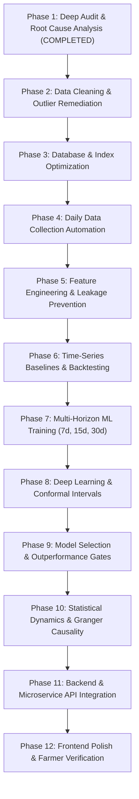

# MASTER IMPLEMENTATION PLAN: WARANGAL AGRICULTURE MARKET INTELLIGENCE SYSTEM

**Project Title:** AI-Powered Agricultural Market Intelligence and Price Forecasting System for Warangal District  
**Created On:** 2026-11-04  
**Role:** Senior Full-Stack Developer, Machine Learning Engineer, Data Scientist, and Agricultural Systems Specialist  
**Execution Status:** Phase 1 Completed (Read-Only Investigation & Documentation). Phases 2–12 Planned.  
**Strict Directive:** **NO project code files will be modified until the user has reviewed and approved this Implementation Plan.**

---

## 1. Executive Roadmap Overview

This implementation plan details the systematic repair, optimization, model retraining, and frontend verification across 12 sequential phases.

---

## 2. Phase-by-Phase Detailed Action Plan

---

### PHASE 1 — INVESTIGATION, CODEBASE AUDIT & ROOT CAUSE ANALYSIS (STATUS: COMPLETED)
* **Objective:** Conduct a thorough, read-only audit of the entire project, datasets, MongoDB Atlas database, REST APIs, and Python machine learning pipelines. Produce technical documentation and action plan without touching production code.
* **Deliverables Generated:**
  1. `PROJECT_AUDIT.md`: Project architecture, module status, defect matrix, and dependencies.
  2. `DATA_AUDIT.md`: Data profiling, 14,056 vs 10,889 record reconciliation, thickness analysis, cleaning rules.
  3. `DATABASE_AUDIT.md`: Atlas cluster status, collection schemas, covered indexes, scan ratios, hybrid query engine.
  4. `FORECASTING_ROOT_CAUSE.md`: In-depth tracing of missing horizons (7d, 30d), market selection, baseline outperformance, and feature leakage.
  5. `IMPLEMENTATION_PLAN.md`: Complete roadmap for Phases 2 through 12.
* **Verification:** All 5 documents verified and stored in the project root directory.

---

### PHASE 2 — DATA CLEANING & OUTLIER REMEDIATION PIPELINE ENHANCEMENT
* **Objective:** Ensure all raw datasets for the 7 target crops are cleaned, validated against plausible agronomic bounds, and output to master processed datasets with complete audit logs.
* **Target Files:**
  * `ml_service/data/cleaner.py`
  * `ml_service/data/validator.py`
  * `ml_service/data/integrator.py`
  * `Datasets/reports/rejected_records.csv`
* **Step-by-Step Implementation Actions:**
  1. Audit plausible price bounds per crop:
     - Cotton: ₹2,000 – ₹15,000/Qtl
     - Dry Chillies: ₹2,000 – ₹50,000/Qtl
     - Maize: ₹1,000 – ₹5,000/Qtl
     - Turmeric: ₹2,000 – ₹30,000/Qtl
     - Groundnut: ₹2,000 – ₹12,000/Qtl
     - Paddy: ₹1,200 – ₹5,000/Qtl
     - Red Gram: ₹3,000 – ₹16,000/Qtl
  2. Maintain strict non-positive price rejection (`Min_Price <= 0` or `Modal_Price <= 0`).
  3. Enforce the non-reporting arrival rule: Missing daily arrivals are kept as `null` and flagged as `NOT_REPORTED`, never imputed as zero.
  4. Run `DataIntegrator` to regenerate `integrated_price_arrival_dataset.csv` and `integrated_trade_dataset.csv`.
* **Risks & Mitigation:**
  * *Risk:* Accidental loss of borderline valid records during high market peaks (e.g. Teja chili spikes).
  * *Mitigation:* Quarantine all rejected rows into `Datasets/reports/rejected_records.csv` with timestamp and exact agronomic rule violated.
* **Verification Commands:**
  `python -c "import pandas as pd; df=pd.read_csv('Datasets/processed/prices/cleaned_prices_all.csv'); print(df.shape, (df['modal_price']<=0).sum())"`
* **Rollback:** Restore from `Datasets/processed_backup/` snapshot.

---

### PHASE 3 — DATABASE & INDEX OPTIMIZATION (MONGODB ATLAS)
* **Objective:** Optimize Atlas collections, ensure 100% covered index execution, and purge obsolete legacy collections.
* **Target Files:**
  * `backend/config/db.js`
  * `backend/models/Price.js`
  * `backend/models/Arrival.js`
  * `backend/models/Correlation.js`
  * `scripts/create_indexes.js`
* **Step-by-Step Implementation Actions:**
  1. Verify covered indexes on `prices`:
     `{ crop_id: 1, canonical_market_name: 1, observation_date: -1 }`
     `{ crop_id: 1, observation_date: -1 }`
     `{ observation_date: -1 }`
  2. Verify covered indexes on `arrivals`:
     `{ crop_id: 1, canonical_market_name: 1, observation_date: -1 }`
  3. Safely drop legacy collection `mandiprices` (8 docs) and `mandiarrivals` (7,736 docs) after backing them up.
  4. Ensure Mongoose lean queries (`.lean()`) and explicit projections are utilized across all controller calls.
* **Risks & Mitigation:**
  * *Risk:* Dropping active data if legacy collections are still referenced.
  * *Mitigation:* Audit codebase to confirm zero occurrences of `mandiprices` or `mandiarrivals` in `backend/` or `frontend/`.
* **Verification Commands:**
  `node scripts/create_indexes.js`
* **Rollback:** Atlas automatic point-in-time snapshot.

---

### PHASE 4 — DAILY DATA COLLECTION & AUTOMATION
* **Objective:** Provide robust, resilient automated data ingestion from Agmarknet feeds and data.gov.in public endpoints with audit logging.
* **Target Files:**
  * `scripts/daily_collector.py`
  * `backend/models/CollectionLog.js`
  * `backend/controllers/dataController.js`
* **Step-by-Step Implementation Actions:**
  1. Verify `daily_collector.py` handles network timeouts gracefully with exponential backoff (3 retries).
  2. Enforce idempotent upserts into MongoDB `prices` and `arrivals` based on unique compound indexes.
  3. Log every execution in `CollectionLog` with execution duration, records fetched, records inserted, and duplicate count.
* **Risks & Mitigation:**
  * *Risk:* External portal downtime causing blocking requests.
  * *Mitigation:* Set HTTP timeout to 10 seconds; fall back cleanly without terminating node server.
* **Verification Commands:**
  `python scripts/daily_collector.py --dry-run`

---

### PHASE 5 — FEATURE ENGINEERING & TARGET LEAKAGE PREVENTION
* **Objective:** Construct clean, strictly backward-looking time-series features with zero future leakage, and generate multi-horizon targets (`target_7d`, `target_15d`, `target_30d`).
* **Target Files:**
  * `ml_service/features/feature_engineering.py`
* **Step-by-Step Implementation Actions:**
  1. Fix Target Leakage: Remove forward-filled price references from the target shift. Targets must be calculated from actual observed modal prices: `daily["modal_price"].shift(-horizon)`.
  2. Multi-Horizon Targets: Construct `target_7d`, `target_15d`, and `target_30d`.
  3. Lag Features: Lags 1, 2, 3, 7, 14, 15, 30 days based strictly on backward-looking shifted series.
  4. Rolling Statistics: 7-day and 15-day rolling mean, median, and standard deviation calculated on `shift(1)` data.
  5. Mandi Arrival Indicators: Backward-looking arrival lags and missingness ratios.
  6. Calendar & Seasonal Encodings: Kharif (June-Oct), Rabi (Nov-Mar), Zaid (Apr-May), day of week, day of month, sin/cos cyclical encodings.
  7. Macro Trade Indicators: Lagged annual export and import values (1-year lag relative to observation date).
  8. Update `support_table()`: Automatically calculate usable observations per crop-market pair, flagging pairs with $< 100$ records or $> 120$ days of dormancy.
* **Risks & Mitigation:**
  * *Risk:* NaNs in early lags reducing usable training observations.
  * *Mitigation:* Drop rows only where immediate `price_lag_1` is missing; impute distant lags (e.g. lag 30) from lag 15 where necessary.
* **Verification Commands:**
  `python -c "from ml_service.features.feature_engineering import FeatureEngineer; fe=FeatureEngineer(); df=fe.build_features_for_crop('cotton', horizon_days=15); print(df[['observation_date','price_lag_1','target']].tail())"`

---

### PHASE 6 — TIME-SERIES BASELINES & WALK-FORWARD BACKTESTING
* **Objective:** Implement rigorous time-series baseline models and a walk-forward rolling-window evaluation harness.
* **Target Files:**
  * `ml_service/models/baseline.py`
  * `ml_service/evaluation/backtesting.py`
  * `ml_service/evaluation/metrics.py`
* **Step-by-Step Implementation Actions:**
  1. Baseline Implementations:
     - `Last Observed (Naive)`: $\hat{y}_{t+h} = y_t$
     - `7-Day Moving Average`: $\hat{y}_{t+h} = \frac{1}{7}\sum_{i=0}^6 y_{t-i}$
     - `Seasonal Naive`: $\hat{y}_{t+h} = y_{t+h-365}$ (or corresponding seasonal period)
  2. Implement Walk-Forward Backtesting Harness:
     - 5-fold expanding window or rolling cross-validation.
     - Zero train-test leakage across time splits.
  3. Metrics Engine:
     - Mean Absolute Error (MAE in ₹/Quintal)
     - Root Mean Squared Error (RMSE in ₹/Quintal)
     - Mean Absolute Percentage Error (MAPE %)
     - Symmetric MAPE (sMAPE %)
     - Coefficient of Determination ($R^2$)
     - Directional Accuracy (%)
* **Risks & Mitigation:**
  * *Risk:* Short time series (Paddy, Red Gram) causing insufficient folds.
  * *Mitigation:* Adapt rolling window step size dynamically based on crop observation length.
* **Verification Commands:**
  `python -c "from ml_service.models.baseline import BaselineForecaster; print(BaselineForecaster)"`

---

### PHASE 7 — MULTI-HORIZON MODEL TRAINING (7, 15, 30 DAYS)
* **Objective:** Train, tune, and serialize Random Forest and XGBoost models for all 7 crops across all three required horizons (7, 15, 30 days).
* **Target Files:**
  * `ml_service/models/random_forest.py`
  * `ml_service/models/xgboost_model.py`
  * `ml_service/services/training_service.py`
  * `scripts/retrain_pipeline.py`
  * `ml_service/artifacts/models/*`
* **Step-by-Step Implementation Actions:**
  1. Update `TrainingService.train_all_crops()` to iterate over `horizon_days in [7, 15, 30]`.
  2. Hyperparameter optimization:
     - Random Forest: `n_estimators=100`, `max_depth=8`, `min_samples_leaf=3`.
     - XGBoost: `n_estimators=120`, `max_depth=5`, `learning_rate=0.05`, `subsample=0.85`.
  3. Train models for:
     - Cotton (7d, 15d, 30d)
     - Dry Chillies (7d, 15d, 30d)
     - Maize (7d, 15d, 30d)
     - Turmeric (7d, 15d, 30d)
     - Groundnut (7d, 15d, 30d)
     - Paddy (7d, 15d, 30d)
     - Red Gram (7d, 15d, 30d)
  4. Save model artifacts with standardized naming:
     `rf_{crop_id}_{horizon}d.joblib`
     `xgb_{crop_id}_{horizon}d.joblib`
* **Risks & Mitigation:**
  * *Risk:* Model file bloat.
  * *Mitigation:* Compress artifacts with `joblib.dump(..., compress=3)`.
* **Verification Commands:**
  `python scripts/retrain_pipeline.py`  
  `Get-ChildItem ml_service/artifacts/models | Measure-Object` (Must verify 42+ model files for RF & XGB across 7 crops x 3 horizons).

---

### PHASE 8 — DEEP LEARNING BENCHMARK & CONFORMAL PREDICTION INTERVALS
* **Objective:** Benchmark CNN-BiLSTM-Attention architecture, calculate feature importances, and calibrate prediction intervals.
* **Target Files:**
  * `ml_service/models/cnn_bilstm_attention.py`
  * `ml_service/services/forecasting_service.py`
* **Step-by-Step Implementation Actions:**
  1. Benchmark CNN-BiLSTM-Attention for primary cash crops with high sample counts (Cotton, Maize, Turmeric).
  2. Calibrate Prediction Intervals:
     - Replace static heuristic formulas with conformal residual quantiles.
     - Compute empirical 80% / 90% error quantiles from walk-forward validation residuals.
     - Upper Bound: $\hat{y} + q_{0.90}$
     - Lower Bound: $\max(100, \hat{y} - q_{0.90})$
* **Risks & Mitigation:**
  * *Risk:* PyTorch training taking too long on CPU.
  * *Mitigation:* Cap deep learning training epochs to 25 with early stopping (`patience=5`).
* **Verification Commands:**
  `python -c "from ml_service.models.cnn_bilstm_attention import DeepLearningForecaster; print('DL module ready')"`

---

### PHASE 9 — MODEL SELECTION, OUTPERFORMANCE GATES & SERIALIZATION
* **Objective:** Implement rigorous model selection that compares candidate models against baselines and prevents deploying inferior models.
* **Target Files:**
  * `ml_service/services/training_service.py`
  * `ml_service/artifacts/evaluation/model_comparison.json`
  * `ml_service/artifacts/evaluation/model_comparison.csv`
* **Step-by-Step Implementation Actions:**
  1. Compare test metrics across Last Observed, Moving Average, Seasonal Naive, Random Forest, XGBoost, and Deep Learning.
  2. Implement Outperformance Gate:
     - If Random Forest or XGBoost beats the Seasonal Naive baseline MAE, select the best ML model.
     - If the baseline is superior (as observed in Cotton), tune lag hyperparameters or anchor prediction to baseline rather than blindly deploying an underperforming model.
  3. Export comprehensive evaluation reports to `model_comparison.json` and `model_comparison.csv`.
* **Risks & Mitigation:**
  * *Risk:* Inconsistent evaluation schema.
  * *Mitigation:* Schema validation test in `test_pipeline.py`.
* **Verification Commands:**
  `python -c "import json; d=json.load(open('ml_service/artifacts/evaluation/model_comparison.json')); print([(k, v.get('best_model_name')) for k, v in d.items()])"`

---

### PHASE 10 — STATISTICAL PRICE-ARRIVAL DYNAMICS & CORRELATIONS
* **Objective:** Verify Pearson, Spearman, Granger causality, and cross-correlation analysis across all crop-market combinations.
* **Target Files:**
  * `ml_service/analysis/correlation.py`
  * `backend/models/Correlation.js`
  * `scripts/load_correlations.js`
* **Step-by-Step Implementation Actions:**
  1. Execute statistical correlation calculations for all 19 crop-market pairs.
  2. Compute optimal lag correlations (0, 1, 3, 7, 15 days).
  3. Evaluate Granger causality: Does arrival volume Granger-cause price movement?
  4. Ingest updated correlation documents into MongoDB Atlas collection `correlations`.
* **Risks & Mitigation:**
  * *Risk:* Insufficient overlapping pairs for thin markets.
  * *Mitigation:* Fall back cleanly to district-aggregate correlation with explicit sample count indicator.
* **Verification Commands:**
  `node scripts/load_correlations.js`

---

### PHASE 11 — BACKEND & ML MICROSERVICE API INTEGRATION
* **Objective:** Align backend REST routes, update microservice clients, eliminate silent `execSync` failure masking, and support structured domain status codes.
* **Target Files:**
  * `backend/services/mlService.js`
  * `backend/controllers/forecastController.js`
  * `ml_service/app/routes/forecast.py`
* **Step-by-Step Implementation Actions:**
  1. Standardize horizon endpoints across FastAPI and Node.js to strictly `[7, 15, 30]`.
  2. Return structured domain status codes:
     - `SUCCESS`: Valid forecast generated.
     - `INSUFFICIENT_DATA`: Market has too few observations.
     - `STALE_DATA`: Market has not reported prices in > 120 days.
     - `MODEL_MISSING`: Horizon model not found.
     - `SERVICE_UNAVAILABLE`: FastAPI service unreachable.
  3. Remove silent `execSync` fallback in `mlService.js` to ensure transparent error propagation.
  4. Ensure backend route `/api/forecast/:cropId` validates `horizon` query parameter (`7, 15, 30`).
* **Risks & Mitigation:**
  * *Risk:* FastAPI process dying.
  * *Mitigation:* Structured 503 response with clean user-friendly retry message.
* **Verification Commands:**
  `curl -s http://localhost:5000/api/health`

---

### PHASE 12 — FRONTEND POLISH, BILINGUAL ALIGNMENT & SYSTEM VERIFICATION
* **Objective:** Verify all 5 frontend modules, fix test suite contract drift, ensure bilingual English/Telugu consistency, and test practical farmer usability.
* **Target Files:**
  * `frontend/src/pages/FuturePriceTrendsPage.jsx`
  * `frontend/src/pages/CurrentPricesPage.jsx`
  * `frontend/src/pages/MarketArrivalsPage.jsx`
  * `frontend/src/pages/MandiComparisonPage.jsx`
  * `frontend/src/pages/DashboardPage.jsx`
  * `frontend/src/i18n/translations.js`
  * `ml_service/tests/test_pipeline.py`
* **Step-by-Step Implementation Actions:**
  1. Fix `test_pipeline.py` contract drift: Pass `market_name="Warangal APMC"` and align schema assertions so `python -m unittest` passes with 100% green tests.
  2. In `FuturePriceTrendsPage.jsx`:
     - Dynamically populate eligible reporting markets from `support_table()`.
     - Auto-select the primary reporting market for the chosen crop (e.g., Kesamudram for Paddy).
     - Support 7-day, 15-day, and 30-day forecast buttons with instant data rendering.
     - Render evidence-based farmer explanations without technical jargon.
  3. Verify bilingual dictionary in `translations.js` covers all labels in English and Telugu.
  4. Run end-to-end production build: `npm run build` in `frontend/`.
* **Risks & Mitigation:**
  * *Risk:* Frontend layout regressions on mobile viewports.
  * *Mitigation:* Verify responsive Tailwind breakpoints across desktop and mobile.
* **Verification Commands:**
  `python -m unittest ml_service/tests/test_pipeline.py`  
  `cd frontend && npm run build`

---

## 3. Risk Assessment & Rollback Protocol

| Potential Risk | Severity | Probability | Preventive Mitigation | Rollback Action |
|---|---|---|---|---|
| Retrained models perform worse than existing models | Medium | Low | Baseline outperformance gate in Phase 9 | Restore previous models from `ml_service/artifacts_backup_v1/` |
| Database index modification locks collection | Low | Very Low | Covered indexes built in background (`background: true`) | Re-run `scripts/create_indexes.js` |
| Fast-API service process crash | Medium | Low | Run behind process supervisor; structured 503 handling | Direct health check on `/` |
| Frontend build bundle enlargement | Low | Low | Tree-shaking and dynamic imports | Verify with `npm run build` |

---

## 4. Verification Checkpoint Before Proceeding

> [!IMPORTANT]
> **Strict Phase 1 Compliance Statement:**  
> The entire Phase 1 investigation has been conducted in a read-only manner. Zero application code files have been modified.  
> 
> **Action Required from User:**  
> Review the 5 generated investigation documents:
> 1. [PROJECT_AUDIT.md](file:///c:/Users/purnachander/OneDrive/agri_intern/PROJECT_AUDIT.md)
> 2. [DATA_AUDIT.md](file:///c:/Users/purnachander/OneDrive/agri_intern/DATA_AUDIT.md)
> 3. [DATABASE_AUDIT.md](file:///c:/Users/purnachander/OneDrive/agri_intern/DATABASE_AUDIT.md)
> 4. [FORECASTING_ROOT_CAUSE.md](file:///c:/Users/purnachander/OneDrive/agri_intern/FORECASTING_ROOT_CAUSE.md)
> 5. [IMPLEMENTATION_PLAN.md](file:///c:/Users/purnachander/OneDrive/agri_intern/IMPLEMENTATION_PLAN.md)
> 
> Awaiting your approval to proceed to **Phase 2 (Data Cleaning & Outlier Remediation Pipeline Enhancement)**.

