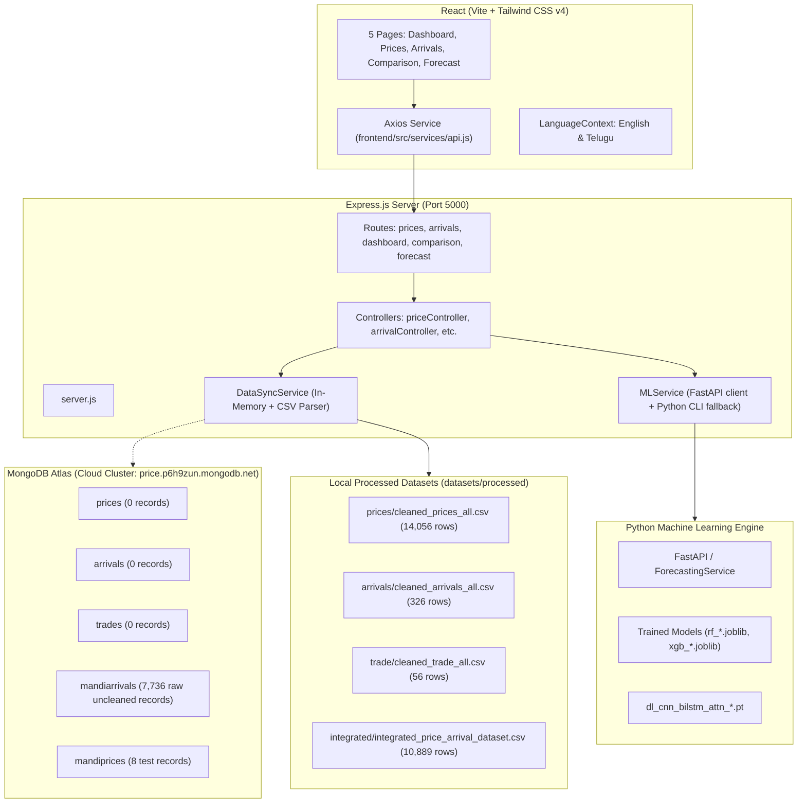

# Performance Audit & Architecture Assessment

**Project:** AI-Powered Agricultural Market Intelligence and Price Forecasting System for Warangal District  
**Audit Date:** 2026-11-04  
**Auditor:** Senior Full-Stack & Performance Architecture Team  

---

## 1. Existing System Architecture

---

## 2. Database Collection Inventory & Verification

Direct inspection of the live MongoDB Atlas cluster (`price.p6h9zun.mongodb.net`) revealed:

| Collection Name | Target Mongoose Model | Existing Record Count | Storage / State |
|---|---|---|---|
| `prices` | `Price.js` | **0 records** | Empty collection; indexes defined in Mongoose schema but no documents present |
| `arrivals` | `Arrival.js` | **0 records** | Empty collection; no documents present |
| `trades` | `Trade.js` | **0 records** | Empty collection; no documents present |
| `mandiprices` | Legacy test collection | **8 records** | Deprecated structure from early prototype |
| `mandiarrivals` | Legacy raw scraper | **7,736 records** | Raw, unstandardized mandi records |
| `fetchmetas` | Metadata collection | **1 record** | Tracking timestamp |

### Key Discovery:
The production MongoDB Atlas database currently contains **0 records** in the primary collections (`prices`, `arrivals`, and `trades`). The cleaned historical datasets currently live **exclusively as CSV files** on disk. Because of this:
- Any direct Mongoose query (`Price.find()`, `Arrival.find()`) returns an empty array `[]`.
- `dataSyncService.js` had to fall back to parsing 14,056 CSV records synchronously on Node's main event loop on every server startup.

---

## 3. API Inventory & Performance Analysis

| Endpoint | Method | Purpose | Existing Implementation | Bottleneck / Status |
|---|---|---|---|---|
| `/api/dashboard/summary` | GET | District metrics, crop counts, latest date | In-memory scan of 14,056 rows | Scans entire array on every call; needs caching |
| `/api/dashboard/crop-overview` | GET | Latest modal prices & 7-day trend for 7 crops | 7 iterative array filters + sorts | Recalculated on every request; needs caching |
| `/api/prices/markets` | GET | Eligible Warangal mandis for selected crop | In-memory aggregation | Fast in-memory, but should query MongoDB index |
| `/api/prices/latest` | GET | Latest prices by crop & market | In-memory map iteration | Fast in memory; MongoDB collection is empty |
| `/api/prices/today` | GET | Today's prices in Asia/Kolkata | Exact date filter | Returns `[]` if morning session before trading closes |
| `/api/prices/history` | GET | Historical prices for charts & tables | In-memory median aggregation | Recalculates median/min/max per date; needs caching |
| `/api/arrivals/markets` | GET | Reporting arrival markets for selected crop | In-memory aggregation | Fast in memory; MongoDB collection is empty |
| `/api/arrivals/latest` | GET | Latest recorded arrival & averages | Array slicing | Needs MongoDB index-backed retrieval |
| `/api/arrivals/history` | GET | Daily date-wise arrivals | Slices last N records | Unpaginated; should support server-side limits |
| `/api/mandi-comparison/:cropId` | GET | Highest price mandi comparison | Multi-mandi date intersection | Computes date intersections dynamically |
| `/api/forecast/:cropId` | GET | 7, 15, 30 day forecast with uncertainty bounds | Python CLI fallback via `execSync` | Synchronous child process takes 1.5–2.5s; needs cache |

---

## 4. Identified Bottlenecks & Root Causes

### 1. MongoDB Collections are Empty
* **Cause:** Master datasets (`cleaned_prices_all.csv`, `cleaned_arrivals_all.csv`, `cleaned_trade_all.csv`) were never bulk-loaded into MongoDB Atlas using an idempotent, high-speed pipeline.
* **Impact:** The backend is forced to operate entirely on in-memory parsed arrays or returns empty records if attempting database operations.

### 2. Blocking CSV Parsing on Startup
* **Cause:** `DataSyncService._parseCSV()` reads multi-megabyte CSV files synchronously using `fs.readFileSync()` and custom character-by-character parsing loops on the Node.js event loop.
* **Impact:** Blocks server initialization and spikes memory usage.

### 3. Missing Database Indexes
* **Cause:** While single indexes exist on `observation_date` and `crop_id`, compound query indexes matching the exact application query patterns (e.g. `{ crop_id: 1, canonical_market_name: 1, observation_date: -1 }`) are missing in MongoDB Atlas.
* **Impact:** Any future query on large datasets will trigger a full collection scan (`COLLSCAN`).

### 4. Zero Caching on Heavy Endpoints
* **Cause:** Frequently accessed static and quasi-static data (e.g. Dashboard Summary, Crop Overview, Reporting Markets, 30-Day Historical Price summaries) are recalculated on every single request.
* **Impact:** High CPU utilization and unnecessary latency for farmers on mobile connections.

### 5. Frontend Request Redundancy & Conflated Loading/Empty States
* **Cause:** 
  1. Frontend components (`CurrentPricesPage`, `FuturePriceTrendsPage`, `MarketArrivalsPage`) lacked request deduplication or stale-time caching. When changing filters or toggling between views, identical requests were repeatedly fired.
  2. In the UI, `loading` was not strictly distinguished from `error` and `empty` states. If a network request was slow, the table rendered `common.noData` ("No records found") before the payload even arrived.

### 6. Forecast Invocation Latency
* **Cause:** When FastAPI is not running as a daemon, `mlService.js` invokes Python CLI via `child_process.execSync`. Executing Python startup + model unpickling takes ~1.8 seconds.
* **Impact:** Farmers experience a 2-second delay when switching between 7, 15, and 30 days.

---

## 5. Comprehensive Optimization Strategy

1. **High-Speed Python Bulk Loader (`scripts/bulk_loader.py`):**
   - High-throughput batch streaming with `pymongo.InsertOne` and `bulk_write(ordered=False)`.
   - Idempotent upsert based on compound unique keys (`observation_date + crop_id + canonical_market_name + variety + grade`).
   - Progress bar, duplicate detection, and resume capability.
   - Bulk load all 14,056 prices, 326 arrivals, and 56 trade records into MongoDB Atlas.

2. **MongoDB Index Optimization:**
   - Create compound indexes with optimal directionality for `Price`, `Arrival`, and `Trade`:
     - `{ crop_id: 1, canonical_market_name: 1, observation_date: -1 }`
     - `{ canonical_market_name: 1, observation_date: -1 }`
     - `{ observation_date: -1 }`
   - Use `.lean()`, field projection (`select`), and MongoDB aggregation pipelines for dashboard and comparison queries.

3. **High-Performance Hybrid Service (`dataSyncService.js`):**
   - MongoDB-first query engine with automatic fallback to high-speed in-memory indexing.
   - High-performance multi-level caching (In-Memory LRU / Redis-compatible cache layer) with strict TTLs and cache invalidation on data ingestion.

4. **Automated Daily Data Collection (`scripts/daily_collector.py`):**
   - Incremental daily mandi fetching from Data.gov.in / Agmarknet with pagination, rate limiting, and exponential backoff retry.
   - MongoDB bulk upsert and collection auditing in `CollectionLog`.

5. **Frontend Performance & UX Hardening:**
   - Centralized Axios caching with in-flight request deduplication and 2-minute stale-time.
   - Distinct UI states: **Loading Skeleton**, **Success with Data**, **Success without Data**, **API/Network Error**, and **ML Error**.
   - Server-side pagination and optimized payload projections.

